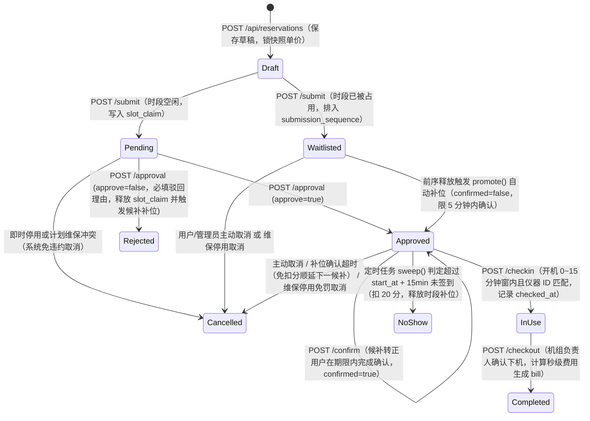

# 02 · 业务规则与状态机详解

> 对照源文件：[../00_事实源/project-card.md](../00_事实源/project-card.md)、[../system/docs/DESIGN.md](../system/docs/DESIGN.md)、[../system/backend/src/main/java/cn/instrumenthub/HubService.java](../system/backend/src/main/java/cn/instrumenthub/HubService.java)

---

## 一、参与者（AC-01 ~ AC-06）与系统角色映射

需求模型定义了 6 类参与者，在后端 `app_user.role` 与后台调度组件中精确落地如下：

| 需求编号 | 参与者名称 | 系统 `role` / 组件 | 数据视野与核心权限边界 |
|---|---|---|---|
| **AC-01** | 送样人（校内师生） | `USER` | 按校内单价 `price` 计费（结算方式：`校内经费卡`）；仅可读写本人预约、资质、违约申诉、通知与检测报告；生产环境须经校内统一身份认证（SSO）登录 |
| **AC-05** | 校外用户 | `EXTERNAL` | 自助注册后 `approved=false`，须勾选个人信息用途同意书并提交加密实名材料，经 `ADMIN` 审核通过后方可访问业务接口；按对外单价 `external_price` 计费（结算方式：`对公转账`） |
| **AC-02** | 仪器负责人 | `MANAGER` | 绑定 `group_id`（机组 ID）；**严格受本机组归属限制**（跨机组操作返回 `403 仅可管理本机组仪器`）；负责本机组预约审批、代签到、下机结算、费用核销与冲正、报告上传、培训初审、设备即时/计划维保 |
| **AC-03** | 平台管理员 | `ADMIN` | 全平台权限：仪器建档/批量导入/外部台账同步、校外用户实名材料解密核验与审批、全量资质查询与撤销、违约申诉复核与设备损坏扣分登记、三口径绩效报表与财务 CSV 导出、操作审计日志与外部网关重试 |
| **AC-04** | 主管部门 | `DEPARTMENT` | **只读监管与财务核对角色**：可查看仪器资源、查询与导出三套口径绩效考核报表（`/api/statistics*`）、导出财务结算明细 CSV（`/api/bills/export`），不参与日常预约或审批修改 |
| **AC-06** | 定时任务 | `ScheduledJobs` + `IntegrationService` | 默认每 `60,000 ms`（1 分钟）自动执行：计划维保启停切换、资质到期前 30 天提醒、上机前 30 分钟提醒、候补确认超时取消顺延、开机 15 分钟未签到违约释放、超时 15 分钟占用扣分、外部网关事件指数退避重投 |

---

## 二、预约单 9 状态机（完整转换规则）

### 2.1 状态流转图

### 2.2 状态转换约束明细表

| 当前状态 | 目标状态 | 触发入口 | 核心前置校验 | 关键副作用 |
|---|---|---|---|---|
| — | `Draft` | `POST /api/reservations` | 角色为 `USER`/`EXTERNAL`；未来 14 天内开放时段且起止为整 00/30 分、同一自然日；样品数 `1..10000`；仪器 `Open` 且无重叠维保 | 按角色快照单价写入 `rate`；`contact` 与 `settlement` 经 AES-GCM 加密落库；草稿可编辑（`PUT`）或删除（`DELETE`） |
| `Draft` | `Pending` | `POST /api/reservations/{id}/submit` | 本人草稿；获取仪器锁；校验有效资质且 `credit >= 60`；`slot_claim` 无重叠半小时行 | 分配 `submission_sequence` 写入 `submitted_order`；按半小时切片插入 `slot_claim`；发站内信+Outbox 通知 |
| `Draft` | `Waitlisted` | `POST /api/reservations/{id}/submit` | 同上，但所选时段在 `slot_claim` 中已存在任一半小时占用 | 分配 `submitted_order` 排队，不写 `slot_claim`；通知已进入候补队列 |
| `Pending` | `Approved` | `POST /api/reservations/{id}/approval` | 本机组 `MANAGER` 或 `ADMIN`；仪器仍 `Open` 且申请人资质/信用仍有效 | `confirmed=true`，发送审批通过通知，记录审计 `reservation.approve` |
| `Pending` | `Rejected` | `POST /api/reservations/{id}/approval` | 本机组 `MANAGER` 或 `ADMIN`；`reason` 必填（1~500 字） | 删除该单 `slot_claim`；触发 `promote()` 按 `submitted_order` 自动递补候补单；通知驳回原因 |
| `Waitlisted` | `Approved` | `HubService.promote()` | 前序预约被驳回、取消、补位超时或 `NoShow` 释放时段；候补人当前仍具备有效资质与信用、预约未到开始时间且释放后全时段空闲 | 抢占 `slot_claim`；置 `confirmed=false`、`confirm_by = now + CONFIRMATION_MINUTES`（默认 5 分钟）；发补位确认通知 |
| `Approved` | `InUse` | `POST /api/reservations/{id}/checkin` | 本人或本机组 `MANAGER`/`ADMIN`；扫码 `instrument_id` 与预约仪器一致；时间处于 `[start_at, min(end_at, start_at + 15min)]`；`confirmed=true`；资质与信用仍有效 | 写入 `checked_at = now`；启动实际机时计量 |
| `InUse` | `Completed` | `POST /api/reservations/{id}/checkout` | 本机组 `MANAGER` 或 `ADMIN`；`now - checked_at > 0 秒` | 写入 `ended_at`；按秒计算 `hours` 与 `amount` 生成唯一 `bill`；入队 `upstream` 结算回写事件 |
| `Approved` | `NoShow` | `HubService.sweep()` | `now > start_at + 15min` 且未签到 | 记 `NoShow` 违约并扣 `20` 信用分；释放 `slot_claim`（若该单有多小时剩余半小时槽位，后续非过期候补仍可利用） |
| `Pending` / `Approved` / `Waitlisted` | `Cancelled` | `POST /cancel`、`sweep()` 或维保接口 | 注意：**普通用户不能主动撤回 `Pending` 单**（仅能取消 `Approved`/`Waitlisted`，`Pending` 需联系机组驳回）；唯有系统维保可免罚取消 `Pending` | 释放 `slot_claim`；主动取消与补位超时取消均触发 `promote()` 顺延下一候补，且不扣信用分 |

> **终态集合**：`Completed`、`Rejected`、`NoShow`、`Cancelled` 四个状态一旦进入，不再接受任何预约状态变更（`transition()` 抛出 `409 当前状态不允许此操作`）。

---

## 三、七大专项业务规则详解

### 3.1 时段粒度与防部分重叠机制（`UC-01` / `UC-04`）
- **查询与预约窗口**：仅限当天起未来 **14 天**（`today` 至 `today + 13`），起止时间必须在仪器 `[open_hour, close_hour]` 范围内，同一天内结束，且分钟必须为 `00` 或 `30`、秒为 `00`。
- **半小时原子槽位**：无论用户一次预约 0.5 小时还是 4 小时，`claim()` 都会按 **30 分钟步长**拆分为多条 `slot_claim(instrument_id, slot_at, reservation_id)` 记录。只要任意一个半小时槽位已被占用，`available()` 即判定冲突并转入候补，彻底杜绝跨时段部分重叠（如 `09:00-11:00` 与 `10:00-12:00`）。

### 3.2 候补公平性与防「囤草稿插队」（`UC-04`）
- 早期若按 `reservation.id` 排序，用户可提前数天创建草稿占据小 ID 从而在热门时段放出时插队。
- 现实现（Flyway `V5`）引入独立自增表 `submission_sequence`：仅在调用 `/submit` 真正提交瞬间生成 `submitted_order`，`promote()` 严格按 `ORDER BY submitted_order, id` 扫描，保证**按实际提交受理先后 FIFO 递补**。
- 补位成功后默认给予 **5 分钟确认期**（`CONFIRMATION_MINUTES` 可配），超时未调 `/confirm` 则自动转 `Cancelled` 并顺延给下一位候补者，不扣信用分。

### 3.3 计费精度、核销与不可篡改冲正（`UC-06`）
- **价格快照**：创建草稿时即将当时的 `price`（校内）或 `external_price`（校外）写入 `reservation.rate`，后续仪器调价不影响历史及已建预约。
- **秒级精确计费**：
  $$\text{hours} = \text{round}\left(\frac{\text{seconds}}{3600},\ 6\right), \quad \text{amount} = \text{round}\left(\frac{\text{rate} \times \text{seconds}}{3600},\ 2\right)$$
  全程使用 `BigDecimal` 与 `RoundingMode.HALF_UP`，消除二进制浮点误差。
- **线下核销与冲正留痕**：一期不接在线支付网关，负责人核对经费卡或对公回单后执行 `verify`（`verified=true`）。若需调整金额（如故障减免或人工取整），执行 `adjust`：
  - **绝不覆盖原始 `bill.amount`**；
  - 实收金额 = `amount + adjustment`（校验实收金额 `≥ 0`）；
  - 每次调整向 `bill_adjustment` 表追加 `previous_adjustment`、`new_adjustment`、`actor_id` 与必填 `reason`，同时将 `bill.verified` 重置为 `false` 要求重新核销。

### 3.4 培训—初审—考核—准入链条（`UC-08`）
1. **报名**：送样人调用 `POST /api/training/enrollments` 报名指定仪器培训（初始 `approved=false`）。
2. **机组初审**：所属机组 `MANAGER` 或 `ADMIN` 调用 `/approve` 确认已完成线下实操/材料初审（未初审直接考试返回 `403`）。
3. **在线考试**：完成 5 道安全规范单选题（每题 20 分，满分 100 分），**`≥ 80` 分合格**，自动签发或续期 **1 年有效期**（`now + 1 year`）的上机资质。
4. **撤销闭环**：`ADMIN` 撤销资质（`revoked=true`）时，同步将 `training_enrollment.approved` 重置为 `false`，防止被撤销者直接重考绕过机组复训初审。
5. **到期提醒**：定时任务提前 **30 天**发送一次复训提醒（`reminder_sent=true` 保证幂等）。

### 3.5 违约扣分、信用停权与申诉复核（`UC-09`）
- **初始信用分**：`100` 分（上限 `100` 分，下限 `0` 分）；**预约准入阈值**：`credit >= 60` 分（低于 60 分禁止提交预约、审批通过、候补转正与上机签到）。
- **三类违约扣分标准**：
  1. `NoShow`（开机后超过 15 分钟未签到）：系统自动扣 **20 分**；
  2. `Overtime`（超过预约 `end_at` 15 分钟仍处于 `InUse` 未下机结算）：系统自动扣 **10 分**；
  3. `Damage`（设备损坏）：由 `ADMIN` 对 `InUse` 或 `Completed` 预约手工核实登记，扣 **1 ~ 100 分**。
- **幂等防重扣与单次恢复**：`violation` 表设 `UNIQUE(reservation_id, kind)`，同一预约同一违约类型绝不重复扣分；用户可提交申诉说明（`appeal`），`ADMIN` 结案（`resolved=true`）若判定成立（`restore=true`），按原扣分值恢复信用分（`LEAST(100, credit + points)`），且已结案记录不可二次恢复。

### 3.6 设备即时停用与计划维保（`UC-10`）
- **使用中保护**：若仪器存在 `InUse` 状态的预约（或计划维保窗口与 `InUse` 重叠），系统拒绝停用（返回 `409`），要求先完成下机结算。
- **即时停用（`stop`）**：仪器状态立即变为 `Maintenance`，该仪器所有 `Pending`/`Approved`/`Waitlisted` 预约全部免违约取消并清空 `slot_claim`，逐一通知用户改约。
- **计划维保（`schedule`）**：仅隔离 `[start_at, end_at]` 计划窗口内的时段并免违约取消冲突预约，不影响其他日期正常预约；到达 `start_at` 时定时任务自动切为 `Maintenance`，到达 `end_at`（或人工 `restore`）自动恢复 `Open`。

### 3.7 三口径绩效报表计算口径（`UC-11`）
对于资产原值达到所选口径门槛（50万 / 20万 / 40万）的每台仪器，在统计区间 `[from, to]` 内：
- **可开放机时（分母 `available_hours`）**：
  $$\text{理论开放机时} = (\text{close\_hour} - \text{open\_hour}) \times (\text{区间天数})$$
  再逐日扣减与每日开放窗口 `[open_hour, close_hour]` 相交的维保时长（最小截断为 `0`）。
- **有效开机机时（分子 `hours`）**：所有 `Completed` 预约的实际使用区间 `[checked_at, ended_at]` 与统计区间 `[from 00:00, to+1 00:00)` 的交集秒数 ÷ 3600（跨日/跨周期自动截断）。
- **对外服务机时（`external_hours`）**：上述交集机时中申请人角色为 `EXTERNAL` 的部分。
- **机时利用率（`utilization`）**：`round(hours * 100 / available_hours, 2)`（分母为 0 时记 `0`）。

---

## 四、重要对照：M2 评审答辩稿 vs 最终落地代码规则差异

> **终期答辩必看**：`09_答辩稿/` 撰写于 M2 需求评审阶段（`2026-11-04`），而 `system/` 完成于开发测试阶段（`2026-11-11`）。汇报最终系统实现时，请以右侧**实际代码口径**为准：

| 规则项 | M2 需求评审稿早期表述（`09_答辩稿/`） | 最终系统落地实现（`system/` 源码） | 演进原因 |
|---|---|---|---|
| **完成用例范围** | 承诺一期跑通 6 个高优先级用例，其余 7 个尽量可用 | **全部 13 个用例（UC-01 ~ UC-13）均已完整实现并通过自动化测试** | 保障课程验收全链路闭环 |
| **未签到扣分值** | 提请老师确认「未签到扣 5 分」 | 落地为 `NoShow` 扣 **20 分**、`Overtime` 扣 **10 分**、`Damage` 扣 **1~100 分**，低于 **60 分**停权（即 3 次爽约即触发停权） | 5 分需爽约 9 次才停权，威慑力不足，调高至 20 分使信用约束在学期内真正生效 |
| **计费粒度与修正** | 曾讨论「0.5 小时取整」及「结算时允许 ±20% 时长微调」 | 按**实际使用秒数 ÷ 3600** 精确计费（`BigDecimal` 到分），修正统一走 **`bill_adjustment` 金额冲正并强制填写原因留痕** | 秒级客观计费消除人工改时长争议，金额冲正满足财务审计与对账 0 偏差要求 |
| **多口径存储方式** | 曾设想仪器表加多值标签字段 | 直接存储精确 `asset_value`（资产原值），报表查询按 `500000` / `200000` / `400000` 实时过滤 | 避免资产调账或口径规则微调时手工同步标签不一致 |
| **候补队列存储** | 曾设想 Redis Sorted Set | 采用数据库 `submission_sequence` 持久化提交序号，Redis 专职承担生产分布式锁 | 避免 Redis 重启丢失候补队列，且与预约状态变更共享同一数据库 ACID 事务 |
| **报表查询方式** | 曾设想写入时预聚合 + 按年分表 | 当前采用带索引实时聚合，20 万条预约基线实测 `3964 ms`（满足 `≤ 5 s` 目标） | 一期单库实时聚合已达标，避免过早引入双写一致性复杂度 |
