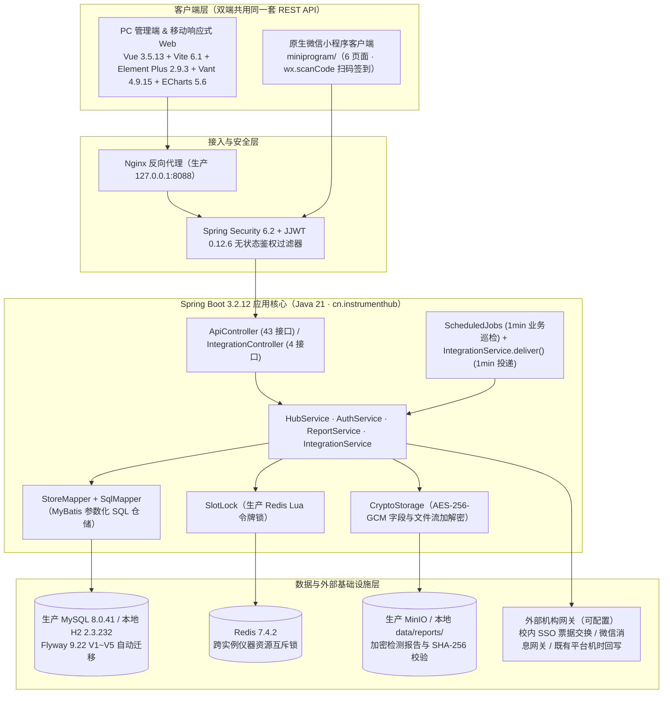

# 03 · 系统架构与源码导读

> 对照源文件：[../system/README.md](../system/README.md)、[../system/docs/DESIGN.md](../system/docs/DESIGN.md)、[../system/backend/pom.xml](../system/backend/pom.xml)、[../system/frontend/package.json](../system/frontend/package.json)

---

## 一、整体技术架构与精确版本栈

---

## 二、后端源码全景（`system/backend/src/main/java/cn/instrumenthub/`）

后端采用高内聚单包（package-private 协作 + 明确边界）设计，共 **17 个 Java 源文件**，职责清晰无冗余样板代码：

| 类名 | 代码行数 | 层次 | 核心职责与关键方法 |
|---|---:|---|---|
| `Application.java` | ~25 | 启动入口 | `@SpringBootApplication` + `@EnableScheduling`，注入全局 `Clock.systemDefaultZone()` 便于测试精确拨表 |
| `SecurityConfig.java` | 96 | 安全配置 | 配置 `BCryptPasswordEncoder`、生产模式默认密钥拒绝门禁（`!demo` 时禁止 `local-demo*` 密钥）、无状态 JWT `OncePerRequestFilter`、放行公开路径（登录/注册/SSO/健康检查/Swagger） |
| `AuthService.java` | 130 | 认证服务 | `login()`（`IP+username` 15 分钟 5 次失败限流 `429`、生产模式拦截校内角色本地密码登录、签发 2 小时有效期 JWT）、`register()`（校外用户注册与实名材料加密落库） |
| `ApiController.java` | 283 | Web 控制器 | 承载 `/api/*` 主业务 **43 个端点**，统一提取 `Principal` 映射当前登录用户，封装 UTF-8 BOM CSV 响应下载 |
| `IntegrationController.java` | 37 | 对接控制器 | 承载 SSO 票据登录（`/api/auth/sso-ticket`）、对接状态查询、外部仪器台账批量同步与失败事件手动重试 **4 个端点** |
| `HubService.java` | 1152 | 核心领域服务 | `@Transactional` 主业务引擎：角色与机组归属校验（`role`/`manager`/`owner`）、仪器与 14 天半小时槽位计算、预约草稿/提交/审批/取消/补位确认/签到/下机结算、账单核销与冲正、即时与计划维保、培训初审与考试发证、违约扣分与申诉、三口径统计计算、分钟级 `sweep()` 巡检 |
| `ReportService.java` | 135 | 报告与导出 | 检测报告上传校验（`≤20MB`、扩展名白名单、PDF `%PDF-` / ZIP `PK` 魔数检验）、AES-GCM 加密存储、授权下载与 SHA-256 完整性复核、绩效与财务 CSV 生成（含防公式注入转义） |
| `IntegrationService.java` | 210 | 外部网关服务 | 校内 SSO 单次票据远端核验与本地 `sso:{subject}` 账号自动映射、外部仪器幂等去重同步（拦截与本地台账同编号冲突）、Transactional Outbox 事件异步投递与指数退避重试 |
| `SlotLock.java` | 49 | 并发控制 | 生产模式基于 Redis `SET key token NX EX 30` 获取仪器锁，注册 Spring `TransactionSynchronization.afterCompletion` 通过 Lua 脚本比对 `token` 安全释放锁 |
| `CryptoStorage.java` | 101 | 密码学存储 | 对 `ENCRYPTION_KEY` 取 SHA-256 得到 256-bit 密钥，使用 `AES/GCM/NoPadding`（12 字节随机 IV + 128-bit 认证标签）提供字符串 `seal()`/`open()` 与文件流 `put()`/`read()`（自动适配本地磁盘或 MinIO） |
| `ScheduledJobs.java` | 20 | 定时调度 | `@Scheduled` 默认 60 秒间隔调用 `HubService.sweep()` |
| `StoreMapper.java` | 65 | 数据访问封装 | 基于参数化 SQL 的轻量级通用仓储（`list`/`one`/`get`/`update`/`insert`），自动回填自增主键；表名仅限应用常量，彻底杜绝 SQL 注入 |
| `SqlMapper.java` | ~30 | MyBatis 接口 | 底层动态参数绑定执行器，配合 `StoreMapper` 将 `?` 占位符安全转换为 MyBatis `#{args[i]}` 预编译参数 |
| `SeedData.java` | 133 | 启动初始化 | 空库首次启动时：生产模式强制校验 `≥16` 位 `BOOTSTRAP_PASSWORD` 仅建 `admin`；演示模式创建 7 个角色账号、4 台仪器及预置上机资质 |
| `TrainingCourse.java` | 31 | 培训题库 | 提供《大型仪器安全与操作基础》5 条核心教材与 5 道标准考核单选题 |
| `Problem.java` | ~15 | 业务异常 | 携带精确 HTTP 状态码与面向用户中文提示的轻量级运行时异常 |
| `Errors.java` | 42 | 全局异常处理 | `@RestControllerAdvice` 统一将 `Problem`、数据库唯一约束冲突（转 `409`）、文件超限/格式错误（转 `400`）与未知异常（转 `500`）转化为安全 JSON，**绝不向外泄露堆栈、SQL 或表结构** |

---

## 三、四大关键工程机制深度剖析

### 3.1 防超卖四层并发控制架构（`NFR-01`）

在同一热门时段遭遇百人瞬时抢约时，系统通过四层协同保证**有效占用恒为 1，其余全部平滑转入有序候补队列，0 超卖、0 脏写**：

1. **第一层：跨实例分布式互斥锁（`SlotLock.acquire(instrumentId)`）**
   - 生产环境开启 `REDIS_LOCK=true` 时，对 `iy:lock:instrument:{id}` 执行原子 `SET NX EX 30` 写入随机 UUID 令牌；
   - 若锁被占用立即返回 `409 预约繁忙，请重试`；若 Redis 故障返回 `503 预约锁服务暂不可用`（Fail-Closed，绝不在锁失效时静默放行）；
   - 锁的释放挂载在 Spring 事务完成回调（`afterCompletion`）上，确保**数据库事务提交落盘之后才释放 Redis 锁**，避免「锁先释放、事务未提交」导致的并发幻读窗口；释放时用 Lua 脚本校验 UUID 令牌，防止误删其他线程的锁。
2. **第二层：数据库悲观行锁串行化（`lockInstrument` / `lockReservation`）**
   - 事务内执行 `SELECT * FROM instrument WHERE id=? FOR UPDATE`，将针对同一台仪器的提交、审批、取消、补位、签到、维保状态变迁严格串行化（本地 H2 开发模式与单库多连接压测即依赖此层实现 500 并发 0 超卖）。
3. **第三层：预约状态机乐观锁（`transition()`）**
   - 所有状态跃迁统一走 `UPDATE reservation SET status=?, version=version+1 WHERE id=? AND version=?`，影响行数不为 1 立即抛 `409` 回滚。
4. **第四层：半小时槽位复合主键物理兜底（`slot_claim`）**
   - `PRIMARY KEY (instrument_id, slot_at)` 在存储引擎层提供最终物理唯一性保障，即使上层任何逻辑出现极端竞态，`DataIntegrityViolationException` 也会回滚事务并由 `Errors` 转为友好 `409` 响应。

### 3.2 敏感数据字段级加密与报告防篡改（`NFR-05` / `NFR-10` / `P4`）

- **落库即加密的敏感字段**：
  - `reservation.contact`（送样人联系方式）
  - `reservation.settlement`（校内经费卡号 / 校外对公账户信息）
  - `identity_review.identity_info` 与 `identity_review.contact`（校外注册实名核验材料）
  以上字段在写入数据库前全部经 `CryptoStorage.seal()` 加密为 `Base64(12B_Random_IV || AES_256_GCM_Ciphertext || 16B_AuthTag)`，每次加密随机生成 IV，相同明文每次密文均不同。
- **检测报告文件安全链**：
  - **上传门禁**：限制 `1B ~ 20MB`，清洗文件名路径穿越字符，白名单限制 `.pdf`/`.csv`/`.txt`/`.zip`，并校验文件头魔数（PDF 必须以 `%PDF-` 开头，ZIP 必须以 `PK` 开头），防止伪造扩展名上传恶意脚本；
  - **存储与下载校验**：对原始字节计算 `SHA-256` 存入 `report_file.checksum`，加密为 `{UUID}.enc` 存入本地或 MinIO；下载时先校验委托人/本机组归属权限，解密后重新计算 `SHA-256` 与库中比对，若底层文件被篡改立即阻断下载并报 `409 报告完整性校验失败`。
- **CSV 公式注入防护**：`ReportService.cell()` 对所有以 `=`、`+`、`@`、` -` 开头的单元格内容自动前置单引号 `'`，防止恶意项目名在 Excel 打开时触发命令执行。

### 3.3 事务型事件投递队列（Transactional Outbox）

为解决「本地业务成功但微信网关或学校既有平台暂时不可用」的一致性问题：
1. 站内通知（`notify()`）与下机结算（`checkout()`）在**同一个本地数据库事务**内向 `integration_event` 表插入 `status='Pending'` 事件。
2. `IntegrationService.deliver()` 每分钟异步拉取到期事件，先原子抢占状态为 `Sending`，携带 `Idempotency-Key: iy-event-{id}` 调用远端网关。
3. 成功则标为 `Delivered`；失败则按指数退避计算下次重试时间 $\min(60,\ 2^{\min(\text{attempts}, 6)})$ 分钟（即 2、4、8、16、32、60 分钟），累计失败达 **8 次**标为 `Failed`，管理员可在前端「系统对接」面板一键重置重试，**外部网络抖动绝不回滚或阻塞校内核心预约结算主流程**。

---

## 四、前端与小程序工程拆解

### 4.1 Web 前端（`system/frontend/`）
- **单页工作空间架构（[App.vue](../system/frontend/src/App.vue)）**：
  - 未登录态展示品牌视觉与「登录 / 校外实名注册」双模式卡片；若地址栏携带 `?ticket=...`，挂载时立即通过 `history.replaceState` 擦除地址栏票据并调用 `/api/auth/sso-ticket` 换取会话令牌（存入 `sessionStorage["iy-token"]`）。
  - 登录态左侧导航栏（移动端自适应切换为快捷导航栏）根据当前用户角色动态裁剪 **11 个业务模块**：
    1. `仪器资源`（全角色可见；`ADMIN` 含新建/编辑/JSON 批量导入按钮；`USER`/`EXTERNAL` 含三步预约抽屉）
    2. `我的预约 / 预约工作台`（除 `DEPARTMENT` 外可见；支持分页、起止日期筛选、状态筛选、草稿编辑删除、审批/驳回、补位确认、签到、下机结算）
    3. `结算与报告`（除 `DEPARTMENT` 外可见；支持费用核销、冲正、加密报告上传与授权下载、`ADMIN` 导出财务 CSV）
    4. `培训与资质`（除 `DEPARTMENT` 外可见；报名、初审、在线学习与 5 题考试、`ADMIN` 撤销资质）
    5. `信用与申诉`（`USER`/`EXTERNAL`/`ADMIN` 可见；违约流水、提交申诉、`ADMIN` 复核恢复与登记设备损坏）
    6. `绩效报表`（`ADMIN`/`DEPARTMENT` 可见；国家/地方/校内三口径切换、ECharts「实际机时 vs 对外机时」双柱状图、考核 CSV 导出与财务 CSV 导出）
    7. `设备维保`（`ADMIN`/`MANAGER` 可见；即时停用、计划维保排期、恢复开放）
    8. `用户审核`（`ADMIN` 专属；查看解密实名材料并批准校外账号）
    9. `操作审计`（`ADMIN` 专属；最近 500 条关键操作、操作人、目标对象与来源 IP）
    10. `系统对接`（`ADMIN` 专属；SSO/微信/上游网关配置状态监控、投递事件队列与失败手动重试）
    11. `消息中心`（全角色可见；未读角标、60 秒后台静默轮询刷新、一键标为已读）
- **按需按模块打包优化**：ECharts 仅按需引入 `BarChart`、`GridComponent`、`TooltipComponent`、`LegendComponent` 与 `CanvasRenderer`，大幅减小生产构建包体积。

### 4.2 原生微信小程序（`system/miniprogram/`）
- 共 **6 个原生页面**（配置见 [app.json](../system/miniprogram/app.json)）：
  - `pages/login/index`：账号密码登录与 Token 本地缓存（`wx.setStorageSync("iy-token")`）
  - `pages/home/index`（Tab 1）：仪器分类与关键词检索、单价展示、跳转预约
  - `pages/book/index`：移动端日期与半小时时段选择、样品与结算信息填写提交
  - `pages/reservations/index`（Tab 2）：预约状态查看、候补确认、取消预约、**`wx.scanCode({ onlyFromCamera: true })` 现场机位扫码签到**、检测报告下载与 `wx.openDocument` 预览
  - `pages/training/index`：移动端安全培训报名、课程阅读与在线答题考核
  - `pages/profile/index`（Tab 3）：个人信息、当前信用分、已获资质列表与站内消息查看
- **机位二维码兼容格式**（见 `pages/reservations/index.js`）：既支持纯数字内容（如 `1`），也支持键值对或 URL 参数形式（正则 `/instrument(?:_id)?[=:](\d+)/`，如 `instrument_id=1` 或 `https://.../checkin?instrument_id=1`），校验 `onlyFromCamera: true` 防止相册截图代签。
