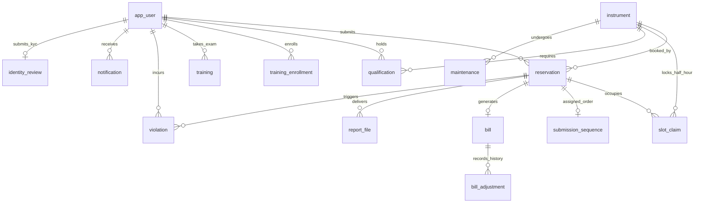

# 04 · 数据库字典与 API 接口手册

> 对照源文件：[../system/backend/src/main/resources/db/migration/](../system/backend/src/main/resources/db/migration/)、[../system/backend/src/main/java/cn/instrumenthub/ApiController.java](../system/backend/src/main/java/cn/instrumenthub/ApiController.java)、[../system/backend/src/main/java/cn/instrumenthub/IntegrationController.java](../system/backend/src/main/java/cn/instrumenthub/IntegrationController.java)、[../system/docs/openapi.json](../system/docs/openapi.json)

---

## 一、Flyway 数据库迁移演进（V1 ~ V5，共 17 张表）

数据库结构由 Flyway 自动版本化管理，**严禁手工改表跳过迁移**：

| 版本 | 脚本文件 | 新增/变更内容 |
|---|---|---|
| **V1** | `V1__initial.sql` | 建立 12 张核心基础表：`app_user`、`instrument`、`qualification`、`reservation`、`slot_claim`、`bill`、`report_file`、`violation`、`maintenance`、`notification`、`audit_log`、`training` 及预约核心索引 |
| **V2** | `V2__training_identity.sql` | 新增 `training_enrollment`（培训初审表）、`identity_review`（校外实名核验加密表）；`qualification` 增加 `reminder_sent`；补齐通知、审计、资质到期索引 |
| **V3** | `V3__audit_integrations.sql` | `audit_log` 增加 `source_ip` 与 `result`；新增 `bill_adjustment`（账单冲正历史流水表）与 `integration_event`（外部网关事件投递队列表） |
| **V4** | `V4__maintenance_plans.sql` | `maintenance` 增加 `applied` 字段及 `(instrument_id, start_at, end_at)` 窗口索引，支持未来时段计划维保 |
| **V5** | `V5__submission_sequence.sql` | 新增 `submission_sequence` 表；`reservation` 增加 `submitted_order` 与候补排序索引 `idx_waitlist_order`，解决草稿创建时间抢占候补顺序问题 |

---

## 二、核心实体关系图（ER Diagram）

---

## 三、全量 17 张数据库表字典

### 1. `app_user`（平台用户表）
| 字段 | 类型 | 约束 / 默认值 | 说明 |
|---|---|---|---|
| `id` | `BIGINT` | `PK, AUTO_INCREMENT` | 用户主键 ID |
| `username` | `VARCHAR(100)` | `NOT NULL, UNIQUE` | 登录账号（SSO 用户格式为 `sso:{subject}`） |
| `password` | `VARCHAR(100)` | `NOT NULL` | BCrypt 哈希密文（SSO 用户存入随机 UUID 哈希不可用密码登录） |
| `name` | `VARCHAR(100)` | `NOT NULL` | 真实姓名 |
| `role` | `VARCHAR(20)` | `NOT NULL` | 角色枚举：`USER` / `EXTERNAL` / `MANAGER` / `ADMIN` / `DEPARTMENT` |
| `group_id` | `BIGINT` | `NOT NULL DEFAULT 1` | 所属机组编号（用于 `MANAGER` 数据隔离） |
| `department` | `VARCHAR(100)` | 可空 | 所属院系或校外单位名称 |
| `approved` | `BOOLEAN` | `NOT NULL DEFAULT FALSE` | 账号是否已通过实名审核（校内种子/SSO 默认 `TRUE`） |
| `credit` | `INT` | `NOT NULL DEFAULT 100` | 当前信用分（`0..100`，`<60` 暂停预约权限） |
| `consent` | `BOOLEAN` | `NOT NULL DEFAULT FALSE` | 是否已同意个人信息保护与用途说明 |

### 2. `identity_review`（校外用户实名审核材料表 · V2）
| 字段 | 类型 | 约束 / 默认值 | 说明 |
|---|---|---|---|
| `id` | `BIGINT` | `PK, AUTO_INCREMENT` | 主键 |
| `user_id` | `BIGINT` | `NOT NULL, UNIQUE` | 关联 `app_user.id` |
| `identity_info` | `VARCHAR(2000)` | `NOT NULL` | **AES-256-GCM 密文**：单位证明、身份与用途材料 |
| `contact` | `VARCHAR(1000)` | `NOT NULL` | **AES-256-GCM 密文**：经办人联系方式 |

### 3. `instrument`（大型仪器台账表）
| 字段 | 类型 | 约束 / 默认值 | 说明 |
|---|---|---|---|
| `id` | `BIGINT` | `PK, AUTO_INCREMENT` | 仪器主键（机位二维码编码值） |
| `code` | `VARCHAR(50)` | `NOT NULL, UNIQUE` | 仪器资产编号（如 `IY-001`） |
| `name` / `model` / `category` | `VARCHAR` | `name NOT NULL` | 仪器名称（120）、型号（120）、分类（80） |
| `group_id` | `BIGINT` | `NOT NULL` | 归属管理机组编号 |
| `department` / `location` | `VARCHAR` | 可空 | 所属机组/院系名称（100）、安放房间位置（150） |
| `price` / `external_price` | `DECIMAL(12,2)` | `NOT NULL` | 校内单价（元/小时）/ 校外对外单价（元/小时） |
| `asset_value` | `DECIMAL(14,2)` | `NOT NULL` | 资产原值（元，用于 50万/40万/20万 三口径过滤） |
| `status` | `VARCHAR(20)` | `NOT NULL` | 运行状态：`Open` / `Maintenance` |
| `source` | `VARCHAR(20)` | `NOT NULL` | 台账来源：`local`（本地可编辑）/ `external`（外部同步只读） |
| `open_hour` / `close_hour` | `INT` | `DEFAULT 8 / 18` | 每日开放起止整点小时（`0..24` 且 `close > open`） |
| `version` | `BIGINT` | `NOT NULL DEFAULT 0` | 乐观锁版本号 |

### 4. `reservation`（预约单主表）
- **索引**：`idx_reservation_resource(instrument_id, status, start_at)`、`idx_reservation_user(user_id, created_at)`、`idx_waitlist_order(instrument_id, status, submitted_order, id)`

| 字段 | 类型 | 约束 / 默认值 | 说明 |
|---|---|---|---|
| `id` | `BIGINT` | `PK, AUTO_INCREMENT` | 预约单号 |
| `user_id` / `instrument_id` | `BIGINT` | `NOT NULL` | 申请人 ID / 预约仪器 ID |
| `start_at` / `end_at` | `VARCHAR(30)` | `NOT NULL` | 预约开始/结束时间（ISO-8601 秒级无纳秒字符串） |
| `status` | `VARCHAR(20)` | `NOT NULL` | 9 状态枚举：`Draft`/`Pending`/`Approved`/`Waitlisted`/`InUse`/`Completed`/`Rejected`/`NoShow`/`Cancelled` |
| `samples` | `INT` | `NOT NULL` | 样品数量（`1..10000`） |
| `project` | `VARCHAR(500)` | 可空 | 检测项目与样品说明 |
| `contact` / `settlement` | `VARCHAR(1000)` | 可空 | **AES-256-GCM 密文**：联系方式 / 经费卡号或对公结算信息 |
| `rate` | `DECIMAL(12,2)` | `NOT NULL` | 创建草稿时锁定的小时单价快照 |
| `created_at` / `checked_at` / `ended_at` | `VARCHAR(30)` | `created_at NOT NULL` | 创建时间 / 实际扫码签到时间 / 实际下机结算时间 |
| `reason` | `VARCHAR(500)` | 可空 | 审批驳回理由或维保免罚取消说明 |
| `confirm_by` / `confirmed` | `VARCHAR(30)` / `BOOLEAN` | `confirmed DEFAULT TRUE` | 候补转正截止确认时间 / 是否已确认（直接提交默认 `TRUE`，候补转正置 `FALSE`） |
| `reminder_sent` | `BOOLEAN` | `NOT NULL DEFAULT FALSE` | 开机前 30 分钟提醒是否已发送（幂等标记） |
| `submitted_order` | `BIGINT` | `NOT NULL DEFAULT 0` | 提交时分配的全局候补排队序号（V5） |
| `version` | `BIGINT` | `NOT NULL DEFAULT 0` | 状态转换乐观锁版本号 |

### 5. `slot_claim`（半小时时段原子占用表）
| 字段 | 类型 | 约束 | 说明 |
|---|---|---|---|
| `instrument_id` | `BIGINT` | `PK (复合主键 1)` | 仪器 ID |
| `slot_at` | `VARCHAR(30)` | `PK (复合主键 2)` | 半小时切片起始时刻（如 `2026-11-12T09:30`） |
| `reservation_id` | `BIGINT` | `NOT NULL` | 当前占用该半小时槽位的有效预约单号 |

### 6. `submission_sequence`（提交受理序号生成表 · V5）
| 字段 | 类型 | 约束 | 说明 |
|---|---|---|---|
| `id` | `BIGINT` | `PK, AUTO_INCREMENT` | 严格按提交顺序递增的全局序号 |
| `reservation_id` | `BIGINT` | `NOT NULL, UNIQUE` | 关联预约单 ID |

### 7. `bill`（费用结算单表）与 8. `bill_adjustment`（账单冲正流水表 · V3）
- **`bill`**：`id` (PK)、`reservation_id` (`UNIQUE`，一单一账)、`hours` (`DECIMAL(12,6)` 实际机时)、`rate` (`DECIMAL(12,2)`)、`amount` (`DECIMAL(12,2)` 原始计算金额，永不覆盖)、`method` (`校内经费卡`/`对公转账`)、`verified` (`BOOLEAN` 是否已线下核销)、`adjustment` (`DECIMAL(12,2)` 当前累计冲正差额)、`adjustment_reason` (`VARCHAR(500)`)。
- **`bill_adjustment`**：`id` (PK)、`bill_id`、`actor_id`、`previous_adjustment`、`new_adjustment`、`reason` (`NOT NULL`)、`created_at`。

### 9. `report_file`（检测报告与原始数据元数据表）
- 字段：`id` (PK)、`reservation_id`、`filename`（清洗后原始名）、`object_key`（`{UUID}.enc` 存储键）、`checksum`（64 位十六进制明文 `SHA-256`）、`size_bytes`、`created_at`。

### 10. `training_enrollment`（培训报名初审表 · V2）、11. `training`（考试记录表）、12. `qualification`（上机资质表）
- **`training_enrollment`**：`id` (PK)、`user_id`、`instrument_id`、`approved` (`BOOLEAN`)，约束 `UNIQUE(user_id, instrument_id)`。
- **`training`**：`id` (PK)、`user_id`、`instrument_id`、`score` (`INT` 每次考试得分流水)、`created_at`。
- **`qualification`**：`id` (PK)、`user_id`、`instrument_id`、`expires_at`（1 年有效期）、`revoked` (`BOOLEAN`)、`reminder_sent` (`BOOLEAN`)，约束 `UNIQUE(user_id, instrument_id)`，索引 `idx_qualification_expiry(expires_at)`。

### 13. `violation`（违约扣分与申诉表）
- 字段：`id` (PK)、`reservation_id`、`user_id`、`kind`（`NoShow`/`Overtime`/`Damage`）、`points`、`reason`、`appeal`（用户申诉词）、`resolved`（是否已复核结案）、`restored`（是否恢复分数），幂等约束 `UNIQUE(reservation_id, kind)`。

### 14. `maintenance`（设备停用与计划维保表 · V1/V4）
- 字段：`id` (PK)、`instrument_id`、`reason`、`start_at`、`end_at`（即时停用可空，计划维保必填）、`closed_at`（恢复后填入关闭时间）、`applied`（计划维保是否已切换仪器状态），索引 `idx_maintenance_window(instrument_id, start_at, end_at)`。

### 15. `notification`（站内消息表）、16. `audit_log`（安全审计日志表）、17. `integration_event`（外部网关事件表 · V3）
- **`notification`**：`id` (PK)、`user_id`、`message`、`is_read`、`created_at`，索引 `idx_notification_user(user_id, id)`。
- **`audit_log`**：`id` (PK)、`actor_id`（系统定时任务记为 `0`）、`action`（如 `auth.login`/`reservation.submit`/`bill.adjust`/`identity.read`）、`object_id`、`created_at`、`source_ip`、`result`，索引 `idx_audit_time(created_at)`。
- **`integration_event`**：`id` (PK)、`channel`（`notification` / `upstream`）、`object_id`、`payload`（JSON）、`status`（`Pending`/`Sending`/`Retry`/`Delivered`/`Failed`）、`attempts`、`next_at`、`last_error`，索引 `idx_event_pending(status, next_at)`。

---

## 四、全量 47 个 REST API 接口与权限速查表

> 鉴权方式：除标注 `公开` 的 3 个认证接口外，其余全部需携带请求头 `Authorization: Bearer <JWT>`，且账号须 `approved=true`（`GET /api/me` 除外，用于未审核校外用户查看自身待审状态）。错误统一返回 `{"message": "中文原因", "status": 4xx}`。

### 4.1 认证与个人会话（4 个）
| 方法 | 路径 | 权限要求 | 请求参数 / Body | 响应说明 |
|---|---|---|---|---|
| `POST` | `/api/auth/login` | 公开 | `{username, password}` | 返回 `{token, user}`；5次错误返回 `429`；生产模式校内角色返回 `403` |
| `POST` | `/api/auth/register` | 公开 | `{username, password, name, department, contact, identity_info, consent:true}` | 密码≥10位；创建待审 `EXTERNAL` 用户并加密实名信息 |
| `POST` | `/api/auth/sso-ticket` | 公开 | `{ticket}` | 向 `SSO_EXCHANGE_URL` 核验单次票据并签发本地 JWT（未配置返 `503`） |
| `GET` | `/api/me` | 已登录 | — | 返回脱敏后的当前用户信息（去除 `password`） |

### 4.2 仪器台账与维保管理（7 个）
| 方法 | 路径 | 权限要求 | 请求参数 / Body | 响应说明 |
|---|---|---|---|---|
| `GET` | `/api/instruments` | 已审核全角色 | `?q=&category=` | 按名称/型号/编号模糊检索及分类过滤 |
| `GET` | `/api/instruments/{id}/slots` | 已审核全角色 | `?date=YYYY-MM-DD` | 未来14天半小时槽位列表（状态：`可约`/`候补`/`停用`/`已过期`） |
| `POST` | `/api/instruments` | `ADMIN` | 仪器表单 JSON | 新建本地仪器台账（`source='local'`），返回 `{id}` |
| `PUT` | `/api/instruments/{id}` | `ADMIN` | 仪器表单 JSON | 编辑本地仪器（若 `source='external'` 返回 `409` 拒绝修改） |
| `POST` | `/api/instruments/import` | `ADMIN` | `List<Instrument>` (1~500条) | 整批事务原子导入仪器台账，返回新增 ID 数组 |
| `POST` | `/api/instruments/{id}/maintenance` | 本机组 `MANAGER` / `ADMIN` | `{action: "stop"\|"schedule"\|"restore", reason, start_at?, end_at?}` | 即时停用、计划维保或恢复开放；自动免罚取消冲突预约 |
| `GET` | `/api/maintenance` | `MANAGER`（本机组）/ `ADMIN`（全局） | — | 查询维保记录列表 |

### 4.3 预约全生命周期（10 个）
| 方法 | 路径 | 权限要求 | 请求参数 / Body | 响应说明 |
|---|---|---|---|---|
| `GET` | `/api/reservations` | 已审核全角色 | `?page=1&size=500&from=&to=` | 按角色隔离视野（`ADMIN` 全局 / `MANAGER` 本机组 / 其他本人），自动解密 `contact`/`settlement` 并附带 `bills` 与 `reports` |
| `POST` | `/api/reservations` | `USER` / `EXTERNAL` | `{instrument_id, start_at, end_at, samples, project, contact, settlement}` | 创建 `Draft` 草稿并锁定单价快照，返回 `{id}` |
| `PUT` | `/api/reservations/{id}` | 草稿本人 | 同上 | 编辑 `Draft` 草稿（乐观锁递增 `version`） |
| `DELETE` | `/api/reservations/{id}` | 草稿本人 | — | 删除 `Draft` 草稿 |
| `POST` | `/api/reservations/{id}/submit` | 草稿本人 | — | 校验资质与信用≥60，加锁抢占槽位，返回 `{id, status: "Pending"\|"Waitlisted"}` |
| `POST` | `/api/reservations/{id}/approval` | 本机组 `MANAGER` / `ADMIN` | `{approve: true\|false, reason?}` | 批准或驳回（驳回必填理由并触发候补递补） |
| `POST` | `/api/reservations/{id}/cancel` | 本人 / 本机组 `MANAGER` / `ADMIN` | — | 取消 `Approved` 或 `Waitlisted` 预约并触发递补 |
| `POST` | `/api/reservations/{id}/confirm` | 本人 / 本机组 `MANAGER` / `ADMIN` | — | 候补补位后在确认期内确认保留时段 |
| `POST` | `/api/reservations/{id}/checkin` | 本人 / 本机组 `MANAGER` / `ADMIN` | `{instrument_id}` | 校验时间窗 `[start, start+15m]` 与仪器码，转 `InUse` 开始计时 |
| `POST` | `/api/reservations/{id}/checkout` | 本机组 `MANAGER` / `ADMIN` | — | 确认下机，转 `Completed` 并返回生成的 `bill` |

### 4.4 结算核销与检测报告（4 个）
| 方法 | 路径 | 权限要求 | 请求参数 / Body | 响应说明 |
|---|---|---|---|---|
| `POST` | `/api/bills/{id}` | 本机组 `MANAGER` / `ADMIN` | `{action: "verify"}` 或 `{action: "adjust", adjustment, reason}` | 线下核销确认，或记录冲正流水并重置核销状态 |
| `GET` | `/api/bills/export` | `ADMIN` / `DEPARTMENT` | — | 导出含 UTF-8 BOM 的 `finance.csv` 并记录 `finance.export` 审计 |
| `POST` | `/api/reservations/{id}/reports` | 本机组 `MANAGER` / `ADMIN` | `multipart/form-data` (`file`) | 仅限 `Completed` 预约；魔数校验+AES-GCM 加密归档，返回 `{id, filename, checksum}` |
| `GET` | `/api/reports/{id}/download` | 预约本人 / 本机组 `MANAGER` / `ADMIN` | — | 解密并复核 `SHA-256` 后返回文件二进制流 |

### 4.5 培训考试与上机资质（8 个）
| 方法 | 路径 | 权限要求 | 请求参数 / Body | 响应说明 |
|---|---|---|---|---|
| `GET` | `/api/training/course` | 已登录 | — | 获取安全教材与 5 道单选题题干选项（不含答案） |
| `POST` | `/api/training/enrollments` | `USER` / `EXTERNAL` | `{instrument_id}` | 幂等提交仪器培训报名 |
| `GET` | `/api/training/enrollments` | 全角色（按角色过滤视野） | — | 查看报名与初审状态 |
| `POST` | `/api/training/enrollments/{id}/approve` | 本机组 `MANAGER` / `ADMIN` | — | 通过培训资格初审 |
| `POST` | `/api/training/{id}/exam` | 已初审通过用户 | `[int, int, int, int, int]` | 提交 5 题选项下标（标准答案 `[1,0,1,2,0]`），≥80分颁发1年资质 |
| `GET` | `/api/qualifications` | 已登录 | — | 查询本人持有的资质列表 |
| `GET` | `/api/qualifications/all` | `ADMIN` | — | 查询全平台所有用户资质列表 |
| `POST` | `/api/qualifications/{id}/revoke` | `ADMIN` | — | 撤销资质并重置培训初审状态 |

### 4.6 违约信用、用户审核、通知、审计、统计与外部对接（14 个）
| 方法 | 路径 | 权限要求 | 请求参数 / Body | 响应说明 |
|---|---|---|---|---|
| `GET` | `/api/violations` | `ADMIN`（全局）/ 其他（本人） | — | 查询违约扣分与申诉记录 |
| `POST` | `/api/violations` | `ADMIN` | `{reservation_id, points, reason}` | 针对 `InUse`/`Completed` 预约登记设备损坏扣分（1~100分） |
| `POST` | `/api/violations/{id}` | 本人（申诉）/ `ADMIN`（复核） | `{appeal}` 或 `{action:"resolve", restore:bool}` | 提交申诉说明，或管理员结案并可选恢复信用分 |
| `GET` | `/api/users` | `ADMIN` | — | 查询全部用户列表 |
| `GET` | `/api/users/{id}/identity` | `ADMIN` | — | 解密查看校外用户实名核验材料（强制写 `identity.read` 审计） |
| `POST` | `/api/users/{id}/approve` | `ADMIN` | — | 批准校外用户实名审核 |
| `GET` | `/api/notifications` | 已登录 | — | 查询本人最近 200 条站内通知 |
| `POST` | `/api/notifications/{id}/read` | 本人 | — | 标记本人通知已读（越权修改他人通知无效） |
| `GET` | `/api/audits` | `ADMIN` | — | 查询最近 500 条操作审计记录 |
| `GET` | `/api/statistics` | `ADMIN` / `DEPARTMENT` | `?caliber=national\|local\|campus&from=&to=` | 按三套口径实时聚合机时、利用率、对外机时、人次与收入 |
| `GET` | `/api/statistics/export` | `ADMIN` / `DEPARTMENT` | `?caliber=...&from=&to=` | 导出三口径考核报表 `statistics.csv` |
| `GET` | `/api/integrations` | `ADMIN` | — | 查看外部网关配置状态与最近 200 条投递事件队列 |
| `POST` | `/api/integrations/instruments` | `ADMIN` | `List<Instrument>` (≤500条) | 幂等同步外部仪器台账（`source='external'`） |
| `POST` | `/api/integrations/events/{id}/retry` | `ADMIN` | — | 手动重置失败或卡住的网关投递事件重新发送 |

> **精确端点计数核对**：`ApiController` 共 43 个 `@*Mapping` 方法 + `IntegrationController` 共 4 个 `@*Mapping` 方法 = **47 个 REST 接口**（`4 + 7 + 10 + 4 + 8 + 14 = 47`）。
