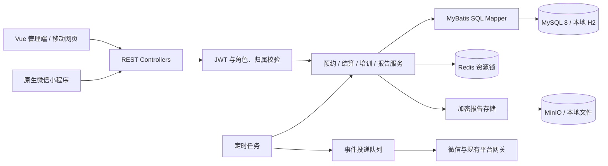
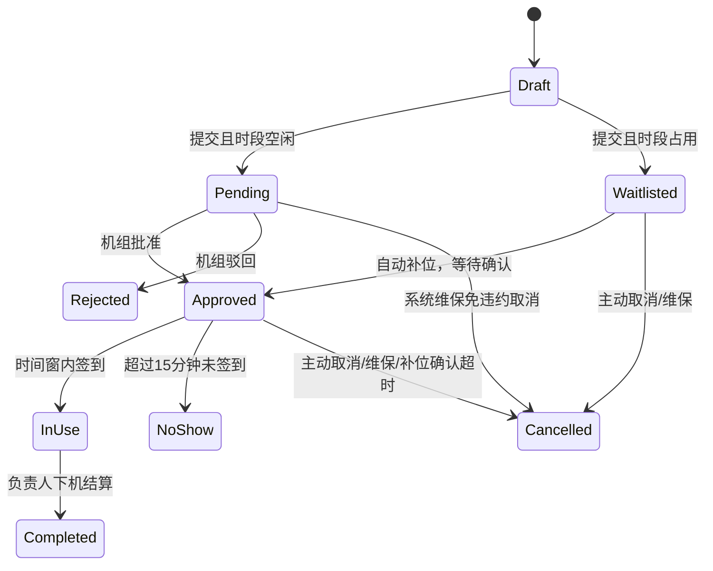

# 系统设计

## 架构

Controller 处理请求与身份，Service 定义事务和业务规则，StoreMapper/SqlMapper 通过 MyBatis 参数绑定访问数据库。业务 SQL 位于服务的仓储调用中，尚未拆成每个领域独立 Mapper XML；这是当前分层与 SRS 约定的一个实现差异。后续可在不改变接口的前提下拆分。

数据库升级使用 Flyway 的 V1—V5 迁移，唯一事实为 `backend/src/main/resources/db/migration/`；不要在已有库上手工重复执行建表语句。

## 数据与一致性

- 用户、仪器、预约、资质、费用、报告元数据、违约、维保、培训、站内消息、审计、投递队列分别存表。
- `slot_claim` 以 `(instrument_id, slot_at)` 为复合主键；多小时预约拆为半小时占用行，从而发现部分重叠。
- 提交、审批、取消、补位、签到、结算通过仪器行锁串行化对同一资源的状态变化，预约表 `version` 作乐观锁校验，数据库主键为最终约束。
- 生产启用 Redis 带随机令牌和过期时间的资源锁；事务完成后用 Lua 比较令牌再删除。锁服务不可用时返回503，竞争时返回409提示重试。开发模式使用数据库锁与唯一约束。
- 候补顺序通过提交时分配的独立序号持久化，按提交获受理顺序扫描，不受草稿创建时间影响。候补确认默认5分钟，可通过 `CONFIRMATION_MINUTES` 修改。
- 候补队列以数据库为事实源，当前没有使用 Redis Sorted Set；进程重启不会丢失候补数据。
- 同一预约只能生成一张费用单。同一预约及违约类型只能记一笔违约，定时扫描不重复扣分。
- 联系方式、经费卡/对公信息、实名材料和报告内容使用 AES-256-GCM 加密；文件元数据保留 SHA-256 完整性校验。
- 原始费用不覆盖；冲正保留 `bill_adjustment` 历史。计费基于实际秒数，以 BigDecimal 四舍五入到分，避免二进制浮点误差。

## 状态机

系统维保可以取消待审批预约；普通用户不能撤回待审批单。完成、驳回、违约、取消后不允许继续执行预约状态动作。

## 费用与报表

预约保留创建草稿时的校内/校外价格快照。实际费用 = 单价 × 实际使用秒数 ÷ 3600，显示机时保留6位小数。冲正后需要重新线下核销。

报表按50万、20万、40万元三个阈值筛选仪器，提供逐仪器行与机组/院系字段。利用率分母是统计周期内开放模板机时减去维保时间，分子是完成使用与统计周期的时间交集。服务人次为有使用时间落在该周期内的预约数量。收入目前按整张费用单归入相交周期，跨周期账单不按时间分摊金额；需要按财务实际结算周期进一步确认。

当前报表同步聚合，没有预聚合表或异步报表归档服务。20万条基线数据的结果见测试报告，百万历史数据和与预约并发时的资源竞争需在生产容量测试中继续验证。

## 安全与边界

JWT 有效期2小时，服务端验证签名和到期时间；授权同时检查角色与机组/数据归属。校外账号先审核，密码使用 BCrypt。校内生产账号通过单次票据交换，不允许使用平台本地密码登录。

上传限制20MB并检查允许扩展名、PDF/ZIP标识；CSV导出处理公式前缀，接口错误不返回堆栈或SQL参数。审计不记录明文密码、证件或经费卡；当前不自动删除审计，满足保留180天的配置意图，实际长期留存仍取决于数据库运维。

系统不控制仪器硬件，不接收支付结果，不实现门禁或采购；签到记录只证明平台登记，真实机位二维码仍需由管理员粘贴和管理。
